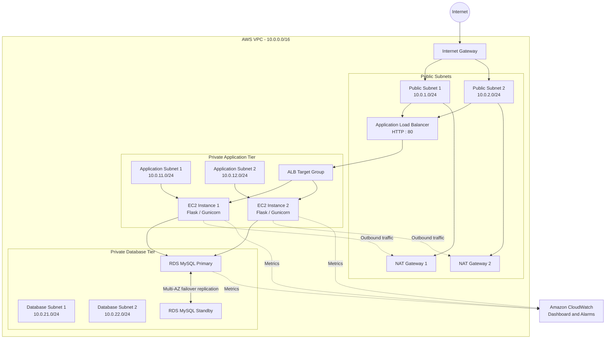

# Project 2 – Highly Available Three-Tier AWS Architecture

## 1. Project Overview

This project demonstrates a highly available, secure, and scalable three-tier
architecture on Amazon Web Services (AWS), provisioned using Terraform.

The architecture separates the presentation, application, and database layers
to improve security, scalability, and maintainability.

## 2. Architecture Components

- Amazon VPC: Isolated network for the application.
- Availability Zones: Two Availability Zones for resilience.
- Public subnets: Host the internet-facing Application Load Balancer.
- Private application subnets: Host EC2 application servers.
- Private database subnets: Host Amazon RDS.
- Internet Gateway: Provides internet connectivity to public subnets.
- NAT Gateways: Allow private application servers to access external services.
- Application Load Balancer: Distributes incoming application traffic.
- EC2 Auto Scaling Group: Maintains and scales application servers.
- Amazon RDS MySQL: Managed relational database with Multi-AZ deployment.
- Security Groups: Control traffic between architecture tiers.
- Amazon CloudWatch: Provides infrastructure monitoring and alarms.

## 3. Network Design

VPC CIDR: 10.0.0.0/16

| Subnet | Availability Zone | CIDR | Purpose |
|---|---|---|---|
| Public Subnet 1 | AZ 1 | 10.0.1.0/24 | ALB and NAT Gateway |
| Public Subnet 2 | AZ 2 | 10.0.2.0/24 | ALB and NAT Gateway |
| Application Subnet 1 | AZ 1 | 10.0.11.0/24 | EC2 instances |
| Application Subnet 2 | AZ 2 | 10.0.12.0/24 | EC2 instances |
| Database Subnet 1 | AZ 1 | 10.0.21.0/24 | RDS subnet group |
| Database Subnet 2 | AZ 2 | 10.0.22.0/24 | RDS subnet group |

## 4. Architecture Diagram

## 5. Security Design

1. The Application Load Balancer is internet-facing.
2. Application EC2 instances are deployed in private subnets.
3. EC2 inbound application traffic is allowed only from the ALB security group.
4. RDS inbound MySQL traffic (TCP 3306) is allowed only from the application security group.
5. Database instances are not directly accessible from the public internet.
6. NAT Gateways provide outbound connectivity for private application instances.
7. Security Groups follow the principle of least privilege.

## 6. High Availability

- Deploy the ALB across two Availability Zones.
- Distribute EC2 instances across two private application subnets.
- Use an Auto Scaling Group to maintain the desired EC2 capacity.
- Configure RDS Multi-AZ for database failover.
- Deploy a NAT Gateway in each Availability Zone.

Note: RDS Multi-AZ provides a standby database for failover. It is not a read replica for read scaling.

## 7. Infrastructure as Code

Terraform will provision and manage the AWS resources using reusable modules:

- Network
- Compute
- Database
- Security
- Monitoring

## 8. Cost and Cleanup

AWS resources such as NAT Gateways, Application Load Balancers, EC2 instances,
and RDS incur charges.

The environment will be deployed for testing and destroyed when no longer needed,
after verifying that important data and Terraform state are safely preserved.
